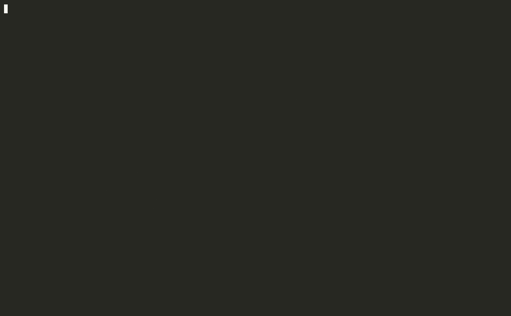

# libft_43

Herramienta para **practicar la libft de 42 antes del examen o de la
defensa**: te pide funciones al azar (dando prioridad a las que fallas),
las escribes desde cero en vim y las testea con
[libftTester](https://github.com/Tripouille/libftTester), la norminette y
las reglas del subject. Cronometra cada intento y te dice cuándo estás
preparado.

> ¿Por qué «43»? Es una broma interna del cursus: los archivos de práctica
> llevan un «43» en la cabecera en lugar del logo de 42.



## Qué hace

- **Te pide una función** y crea `ft_xxx.c` con la cabecera y el prototipo.
  Salen más las que has fallado o no has hecho, y vuelven las que dominas
  cuando toca repasarlas (repetición espaciada).
- **Vim y el menú en la misma ventana** (tmux): escribes a la izquierda y
  con `F5` guardas y testeas.
- **Test completo:** norminette, libftTester con valgrind y reglas del
  subject que libftTester no mira (funciones no autorizadas, `static`,
  variables globales, `ft_is*` que devuelven 1 o 0, `ft_calloc` con 0…).
  Ves cada paso mientras se hace y cada caso con su código y su ✔/✘.
- **Cronómetro** de cada intento: el tiempo hasta que el test sale
  perfecto, y si usaste pistas. Se puede pausar (`z`) o cancelar (`x`); solo
  hay uno a la vez.
- **Tus propios tests:** un main por función en `mains/` (`B` lo abre,
  `b` o `F8` lo compila con tu libft y lo ejecuta con valgrind).
- **Pistas por niveles** sacadas de las [notas](notas/) (puntos clave,
  pseudocódigo, casos límite) y el `man` de cada función.
- **Modo examen:** sin pistas (el man sí), con las funciones clave.
- **¿Preparado?:** te dice qué funciones clave tienes listas y cuáles te
  faltan.

## Requisitos

1. **Tu libft terminada**, con `libft.h` y las 43 funciones. Es para
   practicar con la libft acabada: el test compila tu libft y solo
   sustituye la función que estás practicando (algunos tests usan otras
   funciones, como `ft_lstnew`). Si falta algo, el script te dice qué.
2. **libftTester:**
   ```bash
   git clone https://github.com/Tripouille/libftTester.git ~/libftTester
   ```
3. `bash`, `cc`, `clang++`, `valgrind`, `norminette`, `python3`, `tmux` y
   `vim`. En los ordenadores de 42 Barcelona suele estar todo instalado.
   Opcional: `pdftotext` (para la ficha del subject), Obsidian (para leer
   las notas) y `rich` (`pip install --user rich`: las notas se ven con
   tablas, listas y enlaces bien formateados).

## Instalación

```bash
git clone <url-de-este-repositorio> libft_43
cd libft_43
cp config.example.sh config.sh
vim config.sh          # pon la ruta de tu libft en LIBFT_DIR
./libft_43.sh menu
```

En `config.sh` también puedes cambiar dónde está libftTester, tus propias
notas, el PDF del subject y el email de la cabecera. Es tuyo: no se sube a
git.

## Cómo se practica

```bash
./libft_43.sh menu
```

1. Pulsa **`r`**: te toca una función, se crea su archivo y se abre en vim.
2. Escríbela en vim.
3. Pulsa **`F5`**: se guarda y se testea. Repite hasta que salga ✔.

¿Atascado? **`m`** man · **`i`** pista (otra vez: pseudocódigo) · **`e`**
casos límite. En el menú, **espacio** muestra todas las acciones y **`?`**
la ayuda; la barra de abajo enseña siempre las teclas útiles en cada
momento.

Para cambiar entre vim y el menú: `Ctrl-b` y una flecha, o un clic. Para
copiar texto: Mayús + arrastrar. Vim guarda solo cada pocos segundos. Si
cierras la ventana, la sesión sigue abierta y el cronómetro se pausa:
`./libft_43.sh menu` te devuelve a ella. Si sales de vim, **`⏎`** en el
menú lo vuelve a abrir.

Prefieres tu editor: `./libft_43.sh tui` abre solo el menú (con `a` se
testea solo cada vez que guardas). Ahí `⏎` abre vim igualmente; para
testear sin abrirlo, usa `t`.

## Preparar el examen o la defensa

```bash
./libft_43.sh preparado    # o P en el menú
./libft_43.sh examen       # o E en el menú
```

No hace falta repetir las 43 funciones, sino las **21 funciones clave**:
las 9 de listas, `ft_split`, `ft_strtrim`, `ft_substr`, `ft_atoi`,
`ft_itoa`, `ft_memmove`, `ft_calloc`, `ft_strlcat`, `ft_strnstr`,
`ft_strmapi`, `ft_putnbr_fd` y `ft_isalnum`. Una está **lista** si la has
resuelto desde cero **sin pistas** en los últimos 14 días y no ha fallado
después.

En **modo examen** te toca una función clave y las pistas quedan
bloqueadas hasta que pase el test; el `man` sí está permitido, como en el
examen real.

## Las notas

En [`notas/`](notas/) están las notas de Obsidian que usan las pistas:

- `notas/libft/`: una nota por función (explicación, prototipo, qué dice
  el man y el subject, cómo implementarla, puntos clave y errores
  típicos), un índice, un anexo comparativo y la nota de casos límite con
  un `main` de prueba por función, útil para la defensa.
- `notas/C/`, `notas/Herramientas/` y `notas/42/`: conceptos que enlazan
  (punteros, listas enlazadas, la Norma, valgrind, Makefile…).

Se leen bien en GitHub, pero lo mejor es abrirlas en Obsidian: «Abrir
carpeta como bóveda» → `notas/`. Entonces `O` en el menú abre la nota de
la función seleccionada.

¿Prefieres tus notas? Pon tu bóveda en `NOTES_DIR` (en `config.sh`); el
[manual](docs/manual.md#pistas-de-tus-notas-de-obsidian) explica qué
secciones necesita cada nota.

## Estructura

```
libft_43/
├── libft_43.sh          el script: sugerir, testear, pistas, examen…
├── libft_tui.py         el menú (curses)
├── libft_vim.vim        atajos de vim de la sesión (F5–F8)
├── config.example.sh    plantilla de config.sh
├── docs/manual.md       manual completo (./libft_43.sh help)
├── notas/               notas de Obsidian (bóveda)
└── scripts/
    └── exportar_notas.py   copia las notas desde una bóveda a notas/
```

Lo que generas al practicar se queda en tu ordenador y no se sube (está en
`.gitignore`): tus `ft_*.c`, tus `mains/`, `intentos/` (versiones anteriores de cada
función), `config.sh` y los archivos `.libft_*` (historial, contadores e
intentos en marcha). No se modifica nunca tu libft, ni libftTester, ni las
notas: el test trabaja en una carpeta temporal.

## Comandos

| Orden | Qué hace |
|-------|----------|
| `menu` / `tui` | Vim y el menú juntos / solo el menú |
| `[1\|2\|3]` | Sugerir una función (de una parte o de todas) |
| `examen [1\|2\|3]` / `rendirse` | Examen sin pistas / abandonarlo |
| `new ft_xxx` | Crear el archivo de una función concreta |
| `borrar ft_xxx` | Quitar un archivo (se guarda en `intentos/`) |
| `test [ft_xxx…]` | Testear (sin nombres: todos los `ft_*.c`) |
| `main [ft_xxx]` | Compilar y ejecutar tu main (`mains/main_ft_xxx.c`) |
| `man`, `tip [2]`, `casos`, `nota`, `obsidian` `[ft_xxx]` | Man / pistas de las notas |
| `preparado`, `progreso`, `historial`, `intentos` | Ver cómo vas |
| `cabecera [ft_xxx…]` | Rehacer la cabecera «43» si el plugin de 42 la cambió |
| `help` | El [manual](docs/manual.md) |

## Créditos

- Tests: [libftTester](https://github.com/Tripouille/libftTester), de
  Tripouille.
- Notas, script y menú: FelixRodriguezG (felixrod, 42 Barcelona).
- Uso de IA: el script, el menú y esta documentación se han desarrollado
  con ayuda de Claude (Anthropic).

Para actualizar `notas/` desde una bóveda de Obsidian:
`python3 scripts/exportar_notas.py ~/ruta/a/la/boveda`.

## Licencia

[MIT](LICENSE).
